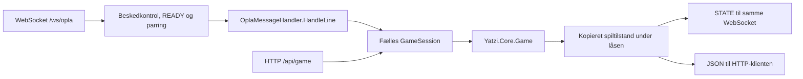

# Oplà-beskedhåndtering

`OplaMessageHandler` omsætter Oplàens tekstlinjer til kast og hold/slip i backendens fælles spil. Handleren bestemmer, hvilken handling der kaldes, mens spilreglerne og tilstanden ligger i `GameSession` og `Yatzi.Core.Game`.

Handleren er implementeret med automatiske tests uden fysisk hardware. HTTP-API, handler og `/ws/opla` bruger samme spilsession. WebSocket-tilkoblingen fra #63 fungerer i alle miljøer og kræver serverparring; standardens READY-behandler parrer ingen forbindelse, så integrationen afprøves gennem testværtens kontrollerede binding. Implementeringen er lokalt slutkontrolleret; afleveringsstatus, merge og CI dokumenteres i [PR #80](https://github.com/Bmantaz/H3-Yatzi/pull/80). Rigtig lobbyparring i #59 og den samlede fysiske forbindelse er fortsat udestående.

## Ansvar og dataflow

| Komponent | Ansvar |
|---|---|
| [OplaMessageHandler](../backend/Yatzi.Api/OplaMessageHandler.cs) | Genkender `ROLL`, `HOLD n` og debug, logger afvisninger og danner `STATE`-svar. |
| [GameSession](../backend/Yatzi.Api/GameSession.cs) | Ejer serverens ene spil i hukommelsen. Udfører handlinger og kopierer tilstanden under samme lås. |
| [Yatzi.Core.Game](../backend/Yatzi.Core/Game.cs) | Håndhæver kast, hold/slip, pointvalg og låsning af turen efter ét feltvalg. |
| [Transportlaget i #63](../backend/Yatzi.Api/OplaWebSocketEndpoints.cs) | Modtager komplette linjer gennem `/ws/opla`, validerer beskeder og adgang og sender hver handler-svarlinje til den samme forbindelse. |



Begge indgange bruger samme session, så et hold gennem HTTP påvirker næste kast gennem handleren og omvendt. Hvert svar bygges fra handlingens eget øjebliksbillede. Handleren foretager ikke et ekstra `GetState()`-kald, som kunne læse en anden klients efterfølgende handling.

Spillet oprettes gennem `POST /api/game/new`, jf. [HTTP-kontrakten](api.md). Et nyt spil erstatter sessionens aktuelle spil; den eksisterende handler følger automatisk med. Tilstanden går tabt ved servergenstart.

## Oprettelse og offentlig metode

[Program.cs](../backend/Yatzi.Api/Program.cs) registrerer både `GameSession` og `OplaMessageHandler` som singletons. Dependency injection leverer den fælles session og `ILogger<OplaMessageHandler>` til handlerens konstruktør. Null som session eller logger giver `ArgumentNullException`.

```csharp
public IReadOnlyList<string> HandleLine(string? line)
```

Metoden er synkron og modtager én komplet tekstlinje uden afsluttende linjeskift. Den returnerer en samling med nul eller flere svarlinjer, også uden linjeskift. De nuværende kommandoer giver præcis én linje ved succes og en tom samling ved afvisning eller debug.

Handleren åbner ingen netværksforbindelse eller seriel-port og gemmer ingen spiller- eller forbindelsesspecifik tilstand. Den nuværende session indeholder én spiller; lobby og multiplayer tilføjes senere.

`PlayerId` er en adgangsbetingelse i forbindelseslaget og sendes ikke til handleren. Flere parrede testforbindelser arbejder derfor på samme enkeltspillerspil; dette er transportintegration, ikke turkontrol eller multiplayer. Handlerens signatur og spilregler er uændrede.

## Input og svar

Formatet følger den aftalte [kommunikationsprotokol](protocol.md). Kommandoer skal have store bogstaver og præcis ét mellemrum mellem felterne. Input bliver hverken trimmet eller ændret til store bogstaver.

| Input | Handling og svar |
|---|---|
| `ROLL` | Kalder `GameSession.Roll()` og returnerer `STATE r hhhhh`. |
| `HOLD 1`–`HOLD 5` | Oversætter terningenummeret til indeks 0–4 og kalder `ToggleHold(index)`. Returnerer `STATE r hhhhh`. |
| En linje med `#` først | Debug; giver ingen logning, svar eller spilhandling. |
| Øvrigt input, inklusive `null` og tom tekst | Logges som ugyldigt input og giver intet svar. |

`STATE 2 01010` betyder to brugte slag og terning 2 og 4 holdt. De fem tegn følger terning 1–5: `1` er holdt, og `0` er sluppet. Terningeværdierne findes i HTTP-API'ets JSON og sendes ikke i `STATE`.

Kast er tilladt i en åben tur indtil og med tredje slag. Hold/slip er kun tilladt i en åben tur efter første eller andet kast og ændrer hverken terningeværdier eller brugte slag. Et nyt tryk på samme terning slipper den igen.

## Sammenhængende eksempel

Opret først et spil med `POST /api/game/new` og JSON-bodyen `{"name":"Andreas"}`. Derefter kan handleren modtage følgende linjer:

| Input | Svar | Betydning |
|---|---|---|
| `ROLL` | `STATE 1 00000` | Første kast; ingen terninger holdt. |
| `HOLD 2` | `STATE 1 01000` | Hold terning 2. |
| `HOLD 4` | `STATE 1 01010` | Hold også terning 4. |
| `ROLL` | `STATE 2 01010` | Andet kast; terning 2 og 4 bevarer deres værdier. |
| `HOLD 2` | `STATE 2 00010` | Slip terning 2. |
| `ROLL` | `STATE 3 00010` | Tredje kast; terning 4 bevarer sin værdi. |
| `ROLL` | Intet svar | Afvises, fordi tre slag er brugt. |
| `HOLD 4` | Intet svar | Afvises, fordi hold/slip er lukket efter tredje slag. |

`GET /api/game` viser tilstanden efter hver handling. Afviste handlinger bevarer den eksisterende tilstand. En sluppet terning kan godt få samme værdi ved næste kast; tilfældige værdier behøver ikke ændre sig.

## Pointvalg gennem HTTP

`POST /api/game/score/{category}` og `/api/game/strike/{category}` bruger samme session som handleren. Efter første, andet eller tredje kast afslutter ét accepteret feltvalg turen og bevarer terninger, hold og brugte slag. Flere `ROLL`- og `HOLD n`-linjer afvises med én Warning pr. linje og en tom svarliste. Der sendes intet `STATE` ved afvisning.

Et nyt spil gennem `/api/game/new` nulstiller også pointtavle og turstatus. Den eksisterende handler bruger derefter automatisk det nye spil. Se [API-kontrakten](api.md) og [pointreglerne](scoring.md).

`STATE r hhhhh` er uændret. Pointvalg tilføjer ingen Oplà-kommandoer eller `WAIT`/`END`; næste tur og disse beskeder følger i #44.

## Afvisninger og logging

- Manglende spil og afviste spilhandlinger giver én Warning med den validerede kommando og årsagen. Handleren opretter ikke automatisk et spil.
- Ukendte eller fejlformaterede linjer giver én Warning med årsagen `Ukendt kommando eller ugyldigt format` og det strukturerede felt `Length`. Feltet er `null`, hvis input er `null`. Den ukendte tekst udskrives ikke.
- Debuglinjer og accepterede handlinger giver ingen logposter fra handleren.
- Kun kernens regelafvisninger af typen `InvalidOperationException` omkring spilhandlingen håndteres. Andre fejltyper videresendes.

Eksempelvis afvises `roll`, `ROLL `, `HOLD 02`, `HOLD 6`, ekstra felter og indlejrede linjeskift. ` # debug` er ugyldigt input, fordi `#` ikke står først. Handleren splitter ikke flere kommandoer i samme input.

## Tilkobling til transport og øvrige opgaver

`/ws/opla` leverer én komplet linje pr. `HandleLine`-kald efter transportkontrol og servervalideret spillerbinding og sender hver svarlinje tilbage på samme forbindelse. Teksten ændres ikke. READY og debug håndteres før handleren. En tom svarliste giver ingen afsendelse, ekstra spilopslag eller ekstra Warning fra transporten. Browser-broens USB-læser skal fjerne linjeafslutningen og bevare linjens øvrige tegn; ved skrivning til USB tilføjer den et linjeskift igen.

Adgangstjekket er accepttidspunktet, og der er intet `await` før handlerkaldet. En allerede godkendt handling kan færdiggøres, selv om forbindelsen senere lukker. Spilhandling og kopieret STATE afsluttes under sessionens lås, før `OplaConnection.SendAsync` afventes uden spil-, tilstands- eller registerlås. Et sendesvigt fortryder eller gentager ikke handlingen og flytter ikke svaret til en ny forbindelse. Se [WebSocket-kontrakten](opla-websocket.md) for kontrolrækkefølge, adgang, levetid og fejlhåndtering.

| Opgave | Ansvar og status |
|---|---|
| #63 | Endpoint i alle miljøer, forbindelsessessioner, READY/adgang, ressourcegrænser og handler-/STATE-integration er implementeret og lokalt slutkontrolleret. PR #80 dokumenterer afleveringsstatus og CI; opgavens færdigkrav er merge og grøn CI på main. |
| #59 | Lobby, parringskoder, `READY`, `PAIR` og `JOINED`. |
| #61 | Browser-bro mellem USB/Web Serial og `/ws/opla`. |
| #35 og #42 | Frontendens rigtige API-kald og løbende visning af ændringer. |
| #44 | Turskifte, flere spillere, `WAIT`, `END` og spillets afslutning. |
| #43 | Samlet fysisk test med Oplà, browser, server og frontend. |

`/ws/opla` er tilkoblet den fælles handler, men producerer ingen rigtig parring før #59. Den eksisterende `/ws/spike` er fortsat et særskilt ekko-endpoint med en fast testkode. Ingen af de lokale backendtests dokumenterer en fysisk forbindelse til spillogikken.

## Kørsel og tests

Kør fra repositoryets rod:

```bash
dotnet build H3Yatzi.sln --configuration Release
dotnet test H3Yatzi.sln --configuration Release
```

Kør kun beskedhåndteringens tests med:

```bash
dotnet test H3Yatzi.sln --configuration Release --filter FullyQualifiedName~OplaMessageHandler
```

[Handler-testene](../backend/Yatzi.Tests/OplaMessageHandlerTests.cs) kontrollerer kommandoer, svar, grænser, debug og logging direkte mod en session. [Integrationstestene](../backend/Yatzi.Tests/OplaMessageHandlerIntegrationTests.cs) henter handleren fra applikationens rigtige servicecontainer og kombinerer den med HTTP gennem en testserver i hukommelsen. Hver testcase har sin egen testvært og session.

Integrationstestene dækker en hel tur, handlinger gennem begge indgange, nyt spil med eksisterende handler samt samtidige kast og hold/slip. Step 7 af #40 tilføjer HTTP-feltvalg efter handlerkast, afvisning efter placering og strygning, genbrug af handleren efter nyt spil samt HTTP-feltvalg samtidig med handlerens `ROLL` og `HOLD`. Handlerens direkte tests kontrollerer én Warning pr. afvist linje efter begge slags feltvalg. Samtidige handlinger frigives fra en fælles startport; resultaterne må komme i vilkårlig rækkefølge.

[WebSocket-spiltestene](../backend/Yatzi.Tests/OplaWebSocketGameIntegrationTests.cs) tilføjer 32 testcases gennem det rigtige endpoint eller kontrollerede transportsockets med samme servicecontainer. De kontrollerer STATE, HTTP-samspil, nyt spil, regelafvisninger uden dobbeltlogning, modtagere, fragmentering, samtidige kast og sendesvigt. READY og logs signaleres gennem channels, og netværksarbejde synkroniseres med tasks uden faste ventepauser. Et ventende STATE spærrer ikke HTTP eller en anden forbindelse; et udført kast gentages ikke ved fejl eller annullering.

**Lokalt efter step 5 af #63:** Release-build bestod med 0 fejl og 0 advarsler, og hele testsuiten bestod med **791 tests**, ingen fejlede eller blev sprunget over. Dette historiske resultat fra den lokale branch lå før GitHub-afleveringen og er ikke en fysisk Oplà-test.

**Lokal slutkontrol i step 6:** Restore og Release-build bestod med 0 fejl og 0 advarsler, og **794 tests bestod** uden fejl eller oversprungne tests. Miljøtestene omfatter Development, Production, Staging og Test samt kontrolleret ROLL/STATE i Production. En separat Production-server bestod lokal transportprøve med rigtig WebSocket-klient; CI-resultater dokumenteres i PR'en. Den fysiske Oplà-integration er fortsat ikke verificeret.

Ved slutkontrollen af #40 bestod hele løsningen med 612 tests og et Release-build med 0 fejl og 0 advarsler. Automatiske tests verificerer backendens samspil uden en åben netværksport eller fysisk hardware. Den samlede fysiske forbindelse og integrationstesten i #43 er fortsat udestående. Afleveringsstatus og CI dokumenteres i [PR #76](https://github.com/Bmantaz/H3-Yatzi/pull/76).
